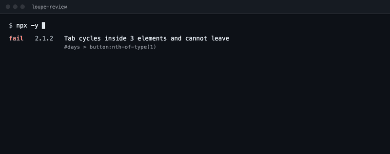

# loupe

[](https://github.com/AshwinSathian/loupe/actions/workflows/ci.yml) [](https://www.npmjs.com/package/loupe-review) [](https://github.com/AshwinSathian/loupe/releases) [](#supply-chain) [](LICENSE) [](https://scorecard.dev/viewer/?uri=github.com/AshwinSathian/loupe)

A design review for your coding agent that measures before it judges. loupe checks an interface against Apple's Human Interface Guidelines and the research around them, measures what it can in the running app, says how strongly Apple states each rule it cites, and tells you when a screen looks like every other template.

```bash
npx skills add AshwinSathian/loupe
```

Then ask in plain words, from the repo you want reviewed: *"review the checkout flow at localhost:3000"*.



*Real output of `loupe-review` on [a fixture page](evals/fixtures/keyboard-app/index.html), regenerated by [tools/make-demo.mjs](tools/make-demo.mjs).*

iOS, iPadOS, macOS, iPhone Duo and the web, in SwiftUI, UIKit, React, Next.js, React Native, Expo, Angular, Vue or plain HTML. Built and tested in Claude Code. It also installs in [Codex, Cursor and Gemini CLI](#other-agents), and its measuring runs anywhere as [a CLI and a GitHub Action](#the-cli-and-github-action).

**[loupe.ashwinsathian.com](https://loupe.ashwinsathian.com)** · [Method](https://loupe.ashwinsathian.com/method) · [Cases](https://loupe.ashwinsathian.com/cases) · [How it was tested](https://loupe.ashwinsathian.com/testing) · [Tools](https://loupe.ashwinsathian.com/tools)

> loupe is an independent project. It is not affiliated with, endorsed by, or sponsored by Apple Inc. See [NOTICE](NOTICE).

## Contents

- [What a review looks like](#what-a-review-looks-like)
- [Why](#why) · [How loupe compares](#how-loupe-compares)
- [Install](#install) · [Other agents](#other-agents)
- [Using it](#using-it)
- [What it measures](#what-it-measures)
- [The CLI and GitHub Action](#the-cli-and-github-action)
- [How it was tested](#how-it-was-tested)
- [What it will and won't do](#what-it-will-and-wont-do)
- [What a review touches](#what-a-review-touches)
- [Supply chain](#supply-chain)
- [Repository](#repository) · [Keeping the Apple digests current](#keeping-the-apple-digests-current) · [Contributing](#contributing) · [License](#license)

## What a review looks like

Three rows from a real report, shortened (the full rows also cite the Apple page each rule comes from): Claude Opus with loupe, reviewing a tool-library page written for the [held-out blind round](evals/heldout/) ([full report](evals/heldout/runs/opus/web-sloppy/skill.md)).

| # | Finding | Where | Impact | Apple | Fix |
|---|---|---|---|---|---|
| 3 | Card meta text (category · note) is #a9b0ab on #fff at 2.21:1, 14 px, on all 6 cards. That includes "Back 14 Nov", the only explanation of why a tool can't be reserved. This fails WCAG 1.4.3 (needs 4.5:1). | Browse tools, every card `.meta`, index.html:33 | Blocker | Web | Use `--muted` #5f6b64 (5.56:1 on #fff, measured) and drop `--faint` for text. |
| 5 | Changing **Loan length** rebuilds the whole dialog (`renderDlg()` on change). The chosen pickup date is cleared (measured: `2026-11-05` became `""`) and focus drops to `<body>`. Submit then fails with "Please fill out this field." | Reserve dialog, index.html:117 | Major | SHOULD | Don't re-render on change. Read both fields on submit, or store `date` from the input's `change` event and keep focus on the select. |
| 6 | **Cancel** deletes a reservation on one click, with no confirm and no undo. The toast says "Done" for 3 s and focus falls to `<body>` (measured). | My reservations, Cancel button, index.html:106–108 | Major | SHOULD | Remove the row, then show a toast with an Undo button for at least 6 s: "Socket set reservation cancelled. Undo". |

Each finding names the element and where it is, carries a measurement or a source line, and has two tags. **Impact** is Blocker, Major, Minor or Polish, and a Blocker needs evidence: a measured or source-confirmed WCAG A/AA failure; an Apple MUST on a native app whose breach stops the task, blocks an accessibility need or risks App Review rejection; data loss; deceptive design; or a task that can't be finished in a release build. **Apple** says how strongly Apple states the rule, copied from its wording (MUST, SHOULD, CONSIDER), or marks the check as Web, Research or Taste.

After the findings come the category landscape (3 to 6 peers, with sources), a distinctiveness verdict, a measured verdict for each typeface, up to three reworks when the evidence clears a stated bar, up to 8 enhancements, a coverage table saying how each check family was checked (measured, from source, by eye, or not at all), and what it couldn't verify. loupe edits nothing until you pick findings by number; then it fixes those and measures again.

## Why

Ask a coding agent for a design review and it will find most of what is wrong; in loupe's blind round, reviews written without it found nearly every planted defect too. What goes wrong is the rest of the review. Contrast is estimated from hex values, severities inflate, and a well-built app gets a list of "critical" problems.

loupe changes how findings are argued and rated. It measures contrast after compositing every translucent layer, walks the page with the keyboard, and stresses it with long and right-to-left text. Each rule it cites shows Apple's own strength, and a Blocker needs evidence. On the well-built control in the blind round, reviews with loupe reported no Blockers, while the same models without it put 10 findings in their top tier.

## How loupe compares

loupe doesn't replace the tools you already use, and most of them are better at their own job. [The full comparison](docs/comparison.md) ([on the site](https://loupe.ashwinsathian.com/compare), checked 17 November 2026) says when to pick each:

- **axe-core or Pa11y** for a broad WCAG gate across many pages: far more rules, years of use. loupe's engine covers 11 ACT rules.
- **Lighthouse** for one score across accessibility, performance and SEO.
- **Impeccable** to steer an agent while it builds, with 24 commands, a live browser mode and support for 19 agents.
- **loupe** when keyboard use and layout under stress matter, when you ship for Apple platforms and want each rule tagged with how strongly Apple states it, or when you want a review with evidence behind every Blocker and a CI baseline.

It also lists what loupe doesn't do: no score, far fewer rules than axe-core, model-written reviews that vary between runs, and a blind test in which it did not find more defects than the same models without it.

## Install

```bash
npx skills add AshwinSathian/loupe
```

Or inside Claude Code:

```
/plugin marketplace add AshwinSathian/loupe
/plugin install loupe@loupe
```

Or clone and symlink it, so `git pull` updates the skill:

```bash
git clone https://github.com/AshwinSathian/loupe.git
mkdir -p ~/.claude/skills
ln -s "$(pwd)/loupe" ~/.claude/skills/loupe
```

To try it without installing: `claude --plugin-dir /path/to/loupe`. As a plugin the skill is named `loupe:loupe`; it also loads on its own when you ask for a design review.

**Requirements.** Measuring a running web app needs the Playwright MCP server (the `playwright` plugin, or any server exposing `browser_*` tools), or a shell where the bundled CLI can run. Without either, loupe works from source and screenshots and lists the measured checks as unverified. Native screenshots use `xcrun simctl` when a simulator is booted. The bundled scripts need Python 3.9 or later.

### Other agents

loupe is a standard `SKILL.md` skill, so other agents can load it. The table says what was checked, because discovering a skill and running a review are different things.

| Agent | Install | Installed to | Checked |
|---|---|---|---|
| Codex CLI | `npx skills add AshwinSathian/loupe -g -a codex` | `~/.agents/skills/loupe` | **Ran Codex CLI 0.169.0.** `codex debug prompt-input`, which prints what the model is given, lists loupe from `~/.agents/skills` and from a repository's `.agents/skills`. Type `$` or `/skills` to pick it. |
| Gemini CLI | `gemini extensions install https://github.com/AshwinSathian/loupe` | `~/.gemini/extensions/loupe/` | **Ran Gemini CLI 0.68.0.** The extension installs from GitHub with real files and `gemini skills list` shows the skill. `gemini skills install https://github.com/AshwinSathian/loupe.git` also works, and so does `npx skills add AshwinSathian/loupe -g -a gemini-cli`, which Gemini finds in `~/.agents/skills`. |
| Cursor | `npx skills add AshwinSathian/loupe -g -a cursor` | `~/.agents/skills/loupe` | **Not run in Cursor** (its CLI needs an account login). Checked against [Cursor's skills documentation](https://cursor.com/docs/skills): it reads `~/.agents/skills/`, and the skill's `name` matches its folder with a `description` present. In Agent chat, type `/` and search for loupe. |

What was not checked: a full review in Codex, Gemini CLI or Cursor. Installation and discovery were; the review workflow itself has only been exercised in Claude Code. SKILL.md uses `${CLAUDE_SKILL_DIR}` for its own folder and falls back to the folder it was loaded from, so other agents resolve its paths.

To measure a web app from these agents, give them a Playwright MCP server, or let them run the CLI from a shell (`npx -y loupe-review@2 <url>`). The MCP commands below were run on the real tools:

```bash
codex mcp add playwright -- npx -y @playwright/mcp@latest
gemini mcp add -s user playwright npx -y @playwright/mcp@latest
```

For Cursor, add the same server to `.cursor/mcp.json`; see [Cursor's MCP documentation](https://cursor.com/docs/mcp).

## Using it

Ask from the repo you want reviewed:

- "Review the checkout flow at http://localhost:3000/cart through to the confirmation page."
- "Do a design review of SettingsView.swift and the screens it pushes."
- "Audit our design system: tokens in src/styles/tokens.json and the components in src/ui."
- "Whole-app review of this Expo app. A simulator is running it."
- "Does this landing page look AI-made?" (with a screenshot)

The first time, loupe drafts a `.loupe.md` profile from your design docs, tokens and manifests (purpose, audience, platforms, build SDK, density, brand, voice, waivers), asks about the gaps in one batch, and writes the file only after you confirm it. Edit it whenever you like; [references/profile-template.md](references/profile-template.md) documents every key.

A review runs in steps: scope, profile, category research, intake and measurement, stress states, nine passes (slop scan, structure, visual, interaction and motion, content, accessibility, platform fit, distinctiveness, red team), then the report. Large apps are split across subagents. [Method](https://loupe.ashwinsathian.com/method) describes each step.

## What it measures

| Input | What is measured | Script |
|---|---|---|
| Running web app | Text contrast after compositing, targets with the WCAG 2.5.8 spacing exception, type sizes, motion that ignores reduced motion, template tells; at 390, 820 and 1440 px, light and dark, reduced motion on and off | [`measure-runner.js`](scripts/measure-runner.js) |
| Running web app | A keyboard walk with real Tab presses: accessible names, visible focus, focus hidden under fixed bars, keyboard traps, reading order | [`interact-runner.js`](scripts/interact-runner.js) |
| Running web app | Stress modes, each undone afterwards: 320 px reflow, WCAG text spacing, 200% text, pseudo-localized text 40% longer, right-to-left | [`stress-runner.js`](scripts/stress-runner.js) |
| Typefaces | Confusable glyphs (I and l), x-height, tabular figures, script coverage | [`type-eval.js`](scripts/type-eval.js) |
| SwiftUI, UIKit, React Native source | Fixed font sizes, Dynamic Type caps, images read aloud by file name, tap gestures with no button trait; which SDK the app is built with, which decides the Liquid Glass checks | [`swift_scan.py`](scripts/swift_scan.py) |
| Booted simulator | Screenshots in light, dark and AX5 text, double-length strings and right-to-left, through Xcode's launch arguments | `xcrun simctl` |
| Design tokens | WCAG contrast for the text and background pairs components use, in every mode of DTCG 2025.10 files | [`tokens.py`](scripts/tokens.py) |
| Screenshots | Contrast sampled from pixels | [`png_contrast.py`](scripts/png_contrast.py) |

Everything else is judged, and the report says which is which.

## The CLI and GitHub Action

The web measuring runs without a model, in Chromium, WebKit or Firefox. It is on npm as [`loupe-review`](https://www.npmjs.com/package/loupe-review) (the name `loupe` was taken); the command is `loupe`.

```bash
npx -y playwright@1.64.1 install chromium
npx -y loupe-review@2 http://localhost:3000/ http://localhost:3000/settings
```

It is published from GitHub Actions with npm trusted publishing: each release since 2.0.2 carries signed provenance, and the repository holds no npm token ([supply chain](#supply-chain)). It prints a markdown summary. Only measured problems that no WCAG exception covers fail a run: text contrast, targets under 24 px without the spacing exception, a focusable control with no name, a keyboard trap outside a dialog, and focus hidden entirely under fixed content. Heuristics, such as a missing focus style or text that clips under stress, are warnings.

| Option | Does |
|---|---|
| `--only measure,interact,stress` | Run some of the three runners (default: all) |
| `--browser chromium\|webkit\|firefox` | Engine; WebKit is walked with Option-Tab, as Safari skips links on Tab |
| `--widths 390,1440` | Widths for measuring and stress |
| `--storage-state <file>` | Playwright storage state, for pages behind a sign-in |
| `--wait-for <selector>` | Wait for an element before measuring |
| `--json <file>`, `--md <file>` | Write every finding as JSON, or the summary as markdown |
| `--baseline <file>` | Compare with a baseline: new, fixed and still-present findings |
| `--update-baseline` | Write the current findings to the baseline file |
| `--fail-on new\|any\|none` | What fails the run (default `new` with a baseline, else `any`) |
| `--allow-file` | Allow `file:` URLs |

Exit codes: `0` pass, `1` findings at the `--fail-on` level, `2` usage, page-load or browser error.

In CI, use the [Loupe Review action](https://github.com/AshwinSathian/loupe-action), or call the CLI yourself. Commit a baseline once, then fail only on new findings:

```yaml
# .github/workflows/loupe.yml
on: pull_request
permissions:
  contents: read
jobs:
  loupe:
    runs-on: ubuntu-latest
    steps:
      - uses: actions/checkout@v7
      - uses: actions/setup-node@v7
        with: { node-version: 22 }
      - run: npm ci && npm run build && (npm run start &) && npx wait-on http://localhost:3000
      - uses: AshwinSathian/loupe-action@v1
        with:
          urls: |
            http://localhost:3000/
            http://localhost:3000/settings
          baseline: loupe-baseline.json
```

Finding ids come from the rule, the role, the text and the colours, not the element's position, so adding a list item doesn't turn one finding into a new one and a fixed one. Write the baseline on the same runner image as the check: fonts change text widths and target sizes. Point it only at pages you control, and keep secrets out of the job, because the browser runs whatever the page runs.

## How it was tested

**The review.** A pre-registered blind round on three fixtures written by model instances that never saw loupe's rules: a flawed web page, a well-built web app, and a SwiftUI app. Claude Haiku, Sonnet and Opus each reviewed every fixture with and without loupe, and three Claude judges compared the pairs without being told which was which.

- Judges preferred loupe's review in 6 of 9 pairs.
- loupe did not find more. Both conditions found nearly every planted defect, and the round's recall rule failed by half a defect with Haiku, so the round failed one of its four rules.
- loupe's reviews had fewer findings judged wrong (24 against 38) or inflated (40 against 52), and no Blockers on the well-built app.

Everything is in [evals/heldout/](evals/heldout/): the pre-registration, fixtures, all 18 reports, the judges' answers, the keys, and [notes on the result](evals/heldout/notes.md). Later development cases, including prompt injection aimed at loupe, are in [evals/cases.md](evals/cases.md) and [evals/results/](evals/results/).

**The measuring engine.**

- `npm run eval:mutation` plants 12 defects at WCAG boundaries (4.48 against 4.54:1, 23 against 24 px) in a clean page, plus 8 decoys that look wrong but pass, with the operators committed under a sha256 before each run. Round 2 detected 12 of 12 and stayed quiet on all 8 decoys. Round 1 found two operators that didn't encode their defect and one engine false positive ([notes](evals/mutation/notes.md)). The same author wrote the engine and the operators, so this is an upper bound.
- `npm run eval:act` runs the W3C ACT Rules test cases, written by others, for the 11 rules the engine covers. It caught 40 of 58 failing cases, with 10 false alarms in 125 passing ones; [the notes](evals/act/notes.md) explain every miss.

**The code.** `npm install && npx playwright install chromium && npm test` runs the scripts and the CLI against fixtures in Chromium (WebKit and Firefox too, when installed), plus the Python scripts and the maintenance tools. CI runs the same on every pull request, with CodeQL.

## What it will and won't do

- **Apple is the core.** Outside research adds to Apple's guidance and never replaces it. Each outside check says whether it adds to an Apple rule, covers ground Apple leaves open, or conflicts with Apple, and a conflict is shown in the finding rather than settled quietly.
- **Measured, or said to be unmeasured.** A Blocker needs a measurement, a source line or a confirmed failure. What couldn't be measured is listed, with what would verify it.
- **The product's look stays the product's.** loupe applies Apple's reasoning to your brand. It never proposes making a product look like Apple's, a competitor's or a trend, Liquid Glass included.
- **"No rework warranted" is the usual answer.** A rework is proposed only when the evidence clears a stated bar; for a well-built product the report says so.
- **Your files stay yours.** Nothing is edited until you pick findings to fix.

## What a review touches

Before you pick fixes, loupe writes only the `.loupe.md` you confirm. It does have side effects, listed in each report's run notes:

- Playwright saves screenshots to `.playwright-mcp/`.
- Simulator appearance and text size change while capturing and are then restored; native stress modes relaunch the app with Xcode's launch arguments.
- The keyboard walk moves focus, so the page's focus handlers run.
- Stress modes and error and offline states are applied in the browser and undone.
- Clearing app data for empty states needs your OK first.
- The landscape step searches the web; say "no web" to skip it.

Text that loupe reads from your pages and from the web reaches the model as evidence. The skill treats it as data and never as instructions, but don't point it at pages you wouldn't paste into a chat.

## Supply chain

- **No stored npm token.** `loupe-review` is published by [`.github/workflows/publish.yml`](.github/workflows/publish.yml) when a GitHub release is published, using npm trusted publishing (OpenID Connect). The repository has no Actions secrets.
- **Signed provenance.** Each release since 2.0.2 carries a signed statement linking the tarball to the commit and workflow run that built it (2.0.1 was published by hand, before the workflow existed). Check it yourself: `npm install loupe-review && npm audit signatures` reports verified registry signatures and attestations.
- **Locked dependencies.** From 2.1.0 the package ships an `npm-shrinkwrap.json`, so `npx loupe-review` installs the dependency tree that was tested, not whatever is newest. It has one runtime dependency, Playwright, pinned to an exact version.
- **No install scripts.** Neither loupe-review nor its dependencies run code when installed; the browser download is a separate, explicit `playwright install`.
- **Skills run with your agent's permissions.** Read `SKILL.md` and `scripts/` before installing, as with any skill. What a review does to your machine is listed under [What a review touches](#what-a-review-touches), and vulnerabilities go through [SECURITY.md](SECURITY.md).

## Repository

```
SKILL.md                   the workflow and the rules (under 5,000 tokens)
references/workflow-*.md   detail for each step, loaded when the step runs
references/apple/          paraphrased digests of Apple's guidance, tagged MUST / SHOULD / CONSIDER
references/augment/        outside research, each check labelled against Apple; red team, landscape, typography
references/slop-catalog.md dated catalog of template tells, kept apart from Apple's rules
references/writing.md      interface copy rules
scripts/                   measure, keyboard and stress runners, type-eval.js, swift_scan.py, tokens.py, contrast.py, png_contrast.py
bin/, lib/                 the CLI and its finding ids, severities and baseline diff
research/digests/          the source digests the references were built from, with their sources
evals/                     review evals (development cases, the held-out blind round) and engine evals (mutation, ACT)
tools/                     snapshot diff, number check, contents check
site/                      the website (not part of the skill)
```

## Keeping the Apple digests current

The digests paraphrase a snapshot of the HIG taken on 23 October 2026, with short attributed quotations. The maintainer refreshes them by hand against developer.apple.com; the repo does not ship a crawler. To check that no number was lost when a reference file is edited: `python3 -I tools/check_numbers.py research/digests/<digest>.md references/<file>.md --allow tools/allow/<file>.txt`. After editing a reference file, run `python3 -I tools/toc.py` to refresh its contents line.

If a rule is wrong or out of date, [open an issue](https://github.com/AshwinSathian/loupe/issues/new/choose) with the Apple page and what it says now.

## Contributing

Reports of wrong findings and outdated rules help most. [CONTRIBUTING.md](CONTRIBUTING.md) covers setup, the checks a reference edit needs, and what the project won't take. Questions go to [Discussions](https://github.com/AshwinSathian/loupe/discussions). Everyone taking part follows the [Code of Conduct](CODE_OF_CONDUCT.md).

## License

MIT for the code and the original text. Quoted and summarised material from Apple and other sources stays with its owners; see [NOTICE](NOTICE).
